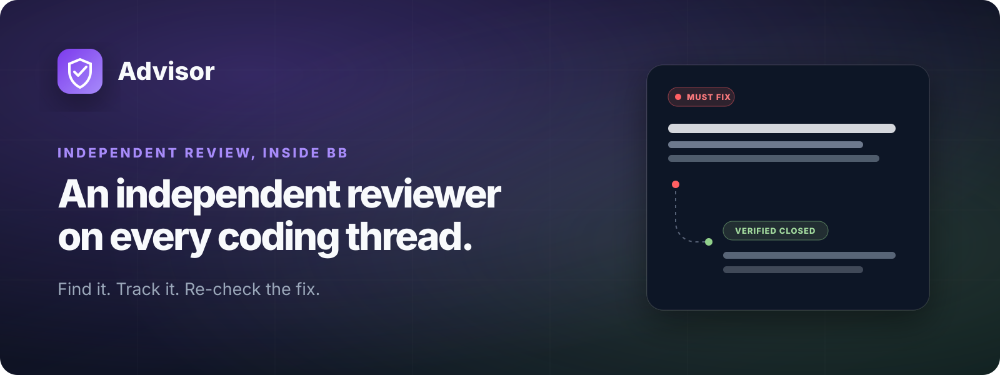
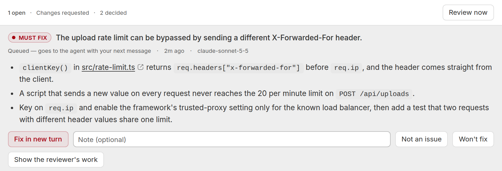
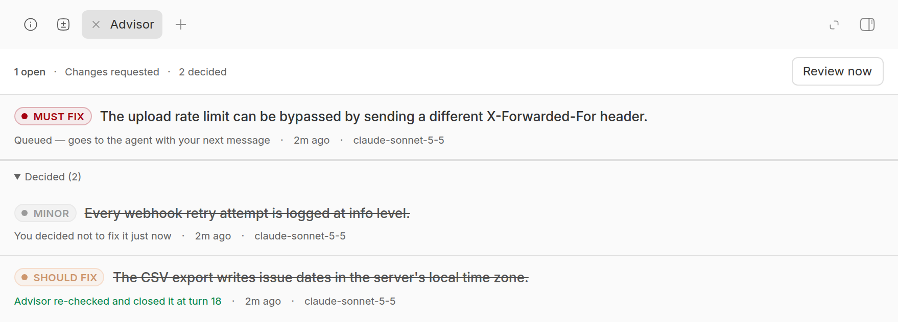
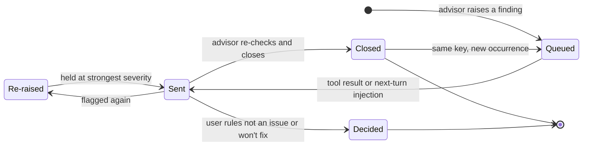
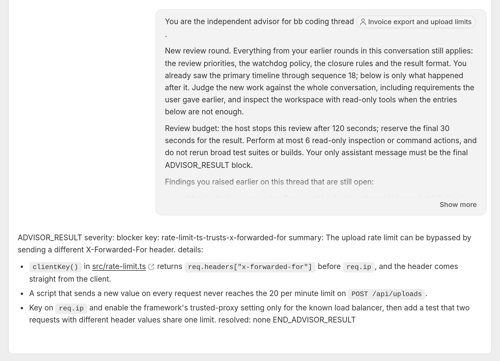

# Advisor

> A persistent, independent reviewer for bb coding threads.

[](https://github.com/salemsayed/bb-plugin-advisor/actions/workflows/ci.yml)
[](./LICENSE)
[](#install)

<p align="center">
  
</p>

Advisor pairs every coding thread with a second model that reviews the work —
before the agent finishes its answer, and again after the turn completes. The
reviewer runs in its own hidden thread with its own context, remembers what it
has already flagged, and escalates when the same defect comes back. A review
that cannot run reports as *unavailable*, never as approval.

Advisor is a bb port of the advisor from
[oh-my-pi](https://github.com/can1357/oh-my-pi) — the design is theirs. See
[Credits](#credits).

<p align="center">
  <a href="https://cdn.jsdelivr.net/gh/salemsayed/bb-plugin-advisor@main/docs/media/advisor-promo.mp4"><strong>Play the 22-second demo →</strong></a>
  <br />
  <sub>Opens in your browser's video player with sound.</sub>
</p>

| Finding, evidence, and decisions | Re-checked and closed |
| --- | --- |
|  |  |

## Why

An agent grading its own work has every incentive to pass it. Advisor adds an
outside opinion without changing bb core:

- **Independent.** Reviews run in a separate, hidden reviewer thread — a
  different context, optionally a different model per machine, spawned into the
  same environment so it can inspect the actual workspace.
- **Persistent.** Findings are chains with memory, not one-off comments. The
  same unresolved defect raised again joins its chain, counts as *re-raised*,
  and is held at its strongest severity, so a finding can escalate but never
  soften. Before repeating it, the reviewer weighs any explanation the agent or
  user gave that it does not apply. A new
  occurrence of a problem that was already dealt with starts its own chain.
- **Fail-closed.** A timeout, a provider that cannot host a reviewer, or a
  reviewer that fails to start is reported as `Advisor unavailable` with the
  reason, and recorded as an incident. It is deliberately not a pass.

## How it works

Advisor reviews a thread through three complementary paths:

1. **`advisor_review` tool** — a mandatory agent tool for substantial work.
   The primary agent must call it once after implementation and verification,
   before its final answer. It runs a review-only pass in the reviewer thread
   and returns concrete findings the agent must address before completing.
2. **Post-turn review** — after a primary thread goes idle with a completed
   public answer, the reviewer checks that answer and the work it claims.
   Actionable late findings are sent to the agent when its next turn starts.
   A turn that already ran the tool is not reviewed again after it goes idle.
   A turn that ends while child threads it started are still running is not
   reviewed on its own: waiting for them is the correct next step, and bb
   wakes the agent when they report. Advisor reviews the turn that ends once
   they have finished. Routine turns, with no tool calls or edits and a
   short answer, are skipped by default; the next review covers everything
   they contained. See [Completed-turn schedule](#completed-turn-schedule).
3. **Review now** — the thread panel can start the same review on demand. If
   the agent is still working, Advisor waits for the completed public answer
   instead of treating the missing answer as a finding.

A button in the thread header advertises the review lifecycle independently
from the agent turn and opens the Advisor tab: **Waiting for completed turn**,
**Waiting for child threads**, **Review pending**, **Approved**, **Changes
requested**, or **Review unavailable**. On a phone it sits at the top of the
thread menu.

Every review is told which of the thread's child threads are still running,
and that an answer honestly waiting for them is not a finding; only a claim that their work is done, or a conclusion that
depends on results they have not returned, is.

A late finding stays attached to the completed turn and offers **Fix in new
turn**, which starts an agent-only corrective follow-up with the finding
already in context. Unresolved findings are also sent into the turn your next
message starts, as an agent-only Advisor message. If that turn finishes before
the agent reads the message, the agent picks it up in a short follow-up turn.
When more than one finding is queued, Advisor carries the whole bounded queue
into that turn — delivering one finding never silently consumes its siblings.
Advice older than 24 hours is retired rather than sent stale.

## Install

Requires bb ≥ 0.49.0 and plugin SDK ≥ 0.6.132. bb 0.47.1 to 0.48.x keep Advisor 0.1.9; older bb releases keep Advisor 0.1.4.

From GitHub:

```sh
bb plugin install git:https://github.com/salemsayed/bb-plugin-advisor.git@main
```

From a local checkout:

```sh
bb plugin install . --yes
```

## Configure

All settings live in **Settings → Extensions → Advisor**.

| Setting | Default | Notes |
| --- | --- | --- |
| Enable advisor | on | Requires an independent review before an agent completes substantial work. |
| Review completed turns | on | Post-turn review; late findings carry into the next turn. |
| Completed-turn schedule | Substantive turns | Which completed turns get a review. See [Completed-turn schedule](#completed-turn-schedule). |
| Review plugin-created threads | on | Review threads other plugins start, such as bot coordinators, Auto Effort workers and automation workers. See [Which threads are reviewed](#which-threads-are-reviewed). |
| Auto-continue on late findings | **off** | See below. |
| Fallback advisor reasoning | inherit | Used only when a machine follows the primary model. |
| Minimum severity | nit | Findings below the threshold are not delivered to the agent. |
| Findings language | empty | Language for finding titles, explanations and suggestions, such as 简体中文 or English. Empty keeps current behavior; plugin UI stays unchanged. Trimmed and limited to 40 characters. Does not apply to the result block's markers, field names, colons or severity values. |
| Additional instructions | empty | Free text appended to the end of the advisor prompt, after the result format. Use it to tune the review without forking the plugin. It cannot change the result block's shape, field names, severity values or markers. Trimmed and limited to 4000 characters; empty adds nothing. |
| Watchdog file | `WATCHDOG.md` | Workspace-relative reviewer policy file. |
| Review timeout | 2 minutes | 30 seconds to 10 minutes. Exceeding it reports unavailable, never a pass. |
| Transcript budget | 60,000 characters | 20,000 to 120,000. |

### Enable Advisor for one thread

Use the Advisor switch beside the model controls in an existing thread's
composer. A thread's choice overrides **Enable advisor** in either direction:
you can turn one thread off while the default is on, or turn one thread on
while the default is off. New threads follow the global setting.

Switching a thread off stops automatic reviews, advice delivery, and automatic
corrective turns, including a correction from a review already in progress.
**Review now** and **Fix in new turn** remain available when explicitly requested.
An agent session that still has the review tool receives an explicit skipped
review response when it calls the tool while the thread is off.

BB fixes an agent session's tools and instructions when it builds that session,
so switching Advisor on in an existing thread takes effect in stages:

- Post-turn reviews start with the next completed turn.
- The next turn you start receives a one-time Advisor message with the policy,
  because the session's own instructions cannot change. If that turn finishes
  before the agent reads it, the agent acknowledges it in a short follow-up
  turn.
- The `advisor_review` tool reaches the agent only once BB rebuilds its session.
  A Claude Code thread picks it up after its runtime restarts; a Codex session
  keeps its original tool list even when resumed.

**Review now** works immediately in the Advisor panel. Clearing model context
starts a fresh session with the tool and instructions in place, but also resets
the agent's working context.

The same controls are available from the CLI. Omit the thread id when running
inside that thread. Use `follow` to clear its override and track the global
setting again:

```sh
bb advisor enable [thread-id]
bb advisor disable [thread-id]
bb advisor follow [thread-id]
```

### Reviewer model, per machine

The model section loads the live provider/model catalog independently from
every connected bb machine. Selections are stored by stable host id, not as
one global model string. Each machine selection includes a reasoning level
populated from that model's live supported-reasoning metadata; choosing
"Model default" tracks the model's reported default.

At review time the plugin routes discovery through the primary thread's
environment and revalidates that machine's saved selection. A machine without
a selection follows the primary thread's provider and model. A disconnected
machine, a model that was removed, or a reasoning level the model no longer
supports also falls back to the primary model. The picker only offers
providers that can host a reviewer in one of the accepted permission modes,
and it never accepts models from an unverified fallback catalog returned after
a provider probe failure.

Falling back to the primary model is checked, not assumed: if the primary
thread's own provider cannot run a reviewer in any accepted mode and that
machine has no advisor model configured, the review reports as unavailable
instead of failing at spawn. A catalog that cannot be read is treated as
inconclusive, so a transient outage does not disable reviews.

### Completed-turn schedule

A completed turn is **routine** when it made no tool calls or edits and its
answer is 1,500 characters or less: a greeting, a clarifying question, a short
factual reply. Everything else is **substantive**.

| Option | Reviews |
| --- | --- |
| Substantive turns (default) | every substantive turn; routine turns are skipped |
| Every completed turn | every turn |
| Every 2nd, 3rd or 5th substantive turn | the Nth substantive turn; routine turns are skipped |

A skipped turn is never dropped: the next review starts where the reviewer
last stopped, so its user message, answer and any work are part of that
review. A turn that waited for running child threads, or whose review was
unavailable, makes the next turn due even when that turn is routine. With an
every-Nth option the last substantive turns of a conversation wait for the
next due review; use **Review now** to review them at once. The mandatory
`advisor_review` tool and **Review now** are not affected by the schedule.

### Which threads are reviewed

Your own visible threads are reviewed while Advisor is on for them. With
**Review plugin-created threads** on, threads other plugins start are
reviewed the same way, visible or hidden: they get the `advisor_review` tool
and its instructions, completed-turn reviews, and late findings in their next
turn. Some plugin threads are never reviewed, whatever the settings:

- Advisor's own reviewer threads, so a reviewer never reviews itself or
  starts a reviewer of its own;
- `composer-predictions` threads, which only write composer suggestions;
- `workflows` subagent threads, whose results are reviewed in the thread that
  started the workflow.

Your own hidden threads are not reviewed. A thread's own Advisor
switch still wins: `bb advisor enable <thread>` turns a plugin thread on even
while the setting is off, and `bb advisor disable <thread>` turns one off.

### Auto-continue on late findings (off by default)

When enabled, Advisor starts the **Fix in new turn** follow-up without a
click: one corrective turn for a newly raised finding chain. It is idempotent
per review round and can fire only once per finding chain, so a persistent
finding cannot create an unattended review loop.

### Project reviewer policy

Place project-specific reviewer policy in `WATCHDOG.md` at the workspace root.
The reviewer reads it before each review; the filename is configurable.

## What the reviewer sees

Each review is one message to the reviewer thread. The first review of a
thread, and any review after the reviewer was respawned or its context was
compacted or cleared, carries the full instructions and the primary timeline
of the last 12 conversation segments. Every later review is shorter: it
repeats the review budget and the result format and sends only the timeline
entries after the sequence the reviewer last reviewed, so a long chat does
not resend the same history every turn and the reviewer's earlier messages
stay a stable, cacheable prefix.

The timeline is rendered as one entry per message, command, edit or tool
call, oldest first:

- Command and tool output keeps its first and last lines, at most 80 lines or
  8,000 characters; edit diffs keep at most 300 lines or 8,000 characters.
  Every cut is marked with the number of lines and characters left out.
- Common secret shapes (API keys, tokens, private keys, passwords in URLs and
  assignments) are redacted before anything is cut, so a cut cannot expose half
  a secret.
- User messages and the final answer are always kept. If the rest does not fit
  the transcript budget, the oldest entries are replaced by a marked gap and the
  reviewer can read the thread or workspace for them.
- Every entry says who it came from. User messages are `USER`, and a message
  another thread sent (a parent's brief, a child's report) is marked with that
  thread. A message or output that quotes Advisor findings, or that carries or
  links another thread's content, gets a `[source note: …]` line. The prompt
  tells the reviewer that only the requests in user messages define the work:
  an Advisor recommendation quoted anywhere is never a user requirement, and a
  linked thread's tasks become this thread's only when a user message here
  explicitly asks for them to be done here.

Each review also lists the user's decisions on this thread's earlier findings
(**Not an issue**, **Won't fix**, a banner dismissal, or a legacy **Fixed**),
newest first, with the severity, the finding's summary and the user's note. The
reviewer must not raise a rejected interpretation again under any key or
wording, while a different defect nearby, or harm the decision did not cover,
is still reported under a new key. Before repeating an open finding, the
reviewer has to weigh any explanation the agent or user gave that it does not
apply, and close it on the `resolved:` line when the explanation holds.

## The life of a finding

The advisor assigns each finding a stable `key` naming the defect itself. A
later round carrying the same key joins that finding's open chain even when it
is reworded or rated differently. A chain is one occurrence of a problem, not
a kind of problem: once the advisor has closed it, the same key starts a new
chain, and a round that names a key on its `resolved:` line while raising the
same key closes the old occurrence and starts a new one. Only a chain that is
still open can make the agent hear "this repeats advice already given".



Every finding carries its own lifecycle, shown in the thread panel:

- **Queued** — found, but its text has not reached the primary agent yet.
- **Sent to the agent** — set at the two moments the finding is actually
  handed over: the tool result, and the Advisor message sent into the next
  turn. *Sent is not resolved* — it only means the agent has seen the
  text.
- **Re-raised N×** — the advisor flagged it again after weighing any
  explanation given since, and still considers it open.
- **Advisor re-checked and closed it** — the reviewer is shown its own open
  findings each round and may name keys on a `resolved:` line that it verified
  are fixed. Silence never closes anything, and it cannot close a key it did
  not raise on this thread. A finding that comes back after closure is a new
  occurrence with its own chain, so the agent is not told it ignored advice it
  acted on.
- **Decided by the user** — **Not an issue** or **Won't fix**, with an
  optional note, stored on the chain root. A user cannot self-certify a fix:
  **Fixed** is established only when a later Advisor round re-checks and
  closes the finding. (Existing legacy `fixed` decisions remain readable.) A
  user decision is authoritative — later matching rounds stay in history but
  never reopen it, and every later review shows the decision to the reviewer,
  so it holds when a round rewords the finding under a new key. Reopening
  clears the decision and any advisor closure together.

Findings resolved before decisions were recorded keep rendering as a plain
dismissal rather than being backfilled with a guess.

Matching normalized advice text is the fallback, used both when the advisor
supplies no key and when a keyed finding misses — which is how a chain that
predates keys stays continuous instead of splitting and softening on its first
keyed round. That fallback applies only above a length floor: terse generic
wording would otherwise merge unrelated findings and hand one an inherited
severity it never earned.

Reviews are persisted in the plugin's SQLite database, keyed by primary thread
and timeline sequence. Deleting a primary thread deletes its review history;
archiving keeps it.

<details>
<summary><strong>Reviewer evidence</strong> — every finding links to the reviewer's own workings</summary>
<br />



</details>

## When model choices load slowly

The model settings wait at most five seconds for each discovery call. A slow or
failed provider is shown with its own error; models from healthy providers
remain available. Use **Refresh models** to retry. A saved model that could not
be loaded stays visibly selected and is not silently changed to Follow primary.
Saving checks only the chosen provider, without rediscovering every catalog.

## When a review cannot run

When the advisor cannot run — the provider does not support the reviewer's
permission mode and no advisor model is configured, the reviewer thread fails
to start, the review exceeds the timeout, or the primary turn fails or ends
without a completed public answer — the tool reports `Advisor unavailable`
with the reason. No review row is recorded (the run still appears in the
[usage ledger](#usage-ledger)), and pending advice from an earlier
turn stays pending. A waiting **Review now** request is settled as unavailable
and can be retried instead of remaining stuck. Cancelling the primary turn
stops the reviewer thread.

Claude Code in Accept Edits mode can still ask for approval before running a
shell command. Because the reviewer thread is hidden, that request can leave a
review waiting until it times out. Use **Show reviewer** to inspect the pending
request and approve only commands you intend to allow, then retry the review.
Increasing the timeout alone does not resolve an unanswered approval. A reviewer
may instead assess the supplied transcript; its result should say when it did
not independently run commands.

## The reviewer thread

Reviewer threads are hidden and reused so the advisor keeps its own context. A
session is bound to the environment it was spawned into; if the primary thread
moves, the reviewer is respawned rather than left inspecting the old checkout.

The reviewer's permission mode is negotiated per review against what the
provider actually advertises, narrowest first. bb briefly offered a `readonly`
mode and removed it again, so on current bb the narrowest mode a reviewer can
be spawned in is `accept-edits`, and a provider that offers nothing narrower
than `auto` is reported as unable to host a reviewer. The preference stays a
list rather than a pinned value: once an SDK publishes a narrower mode, adding
it to `ADVISOR_PERMISSION_MODE_PREFERENCE` in `server.ts` is the whole change.

A session spawned under a mode that is no longer the negotiated one is retired
rather than reused — including a session left over from a bb that still had
`readonly` — so the reviewer never stays pinned to a mode the host can no
longer validate.

When the provider catalog cannot be read, the mode is probed narrowest-first
rather than assumed, and a mode the host accepted before is tried first. A
transient outage therefore neither disables reviews nor silently widens them.

## Inspect

```sh
bb advisor status [thread-id]
bb advisor reviews [thread-id] [--json]
bb plugin logs advisor -f
```

### Usage ledger

Every review run is recorded in the `advisor_review_runs` table of the
plugin database, one row per run: reviewed, unavailable, and skipped by the
completed-turn schedule. `bb advisor reviews` lists a thread's recent runs
after its findings, `--json` prints both, and the `reviewLedger` RPC returns
runs for one thread or all of them (`{ "threadId"?, "since"?, "limit"? }`,
newest first).

| Column | Meaning |
| --- | --- |
| `trigger` | `tool`, `post-turn` or `manual` |
| `outcome`, `reason` | `reviewed`, `unavailable` with its reason, or `skipped` with `routine`, `cadence` or `waiting-for-children` |
| `review_id`, `severity` | the stored review and its verdict |
| `source_seq` | primary timeline sequence reviewed |
| `evidence_mode`, `evidence_from_seq`, `evidence_to_seq`, `prompt_chars` | `full` or `incremental`, the entries sent and the size of the message |
| `carried_turns` | turns since the last completed review that this run covered |
| `advisor_thread_id`, `provider_id`, `model`, `reasoning_level` | the reviewer that ran |
| `started_at`, `finished_at`, `elapsed_ms` | wall time of the run |
| `usage_status` | `recorded`, `unknown` (the provider reported nothing new), `pending` (still being read) or `none` (no model was asked) |
| `input_tokens`, `cached_input_tokens`, `cache_read_tokens`, `cache_write_tokens`, `output_tokens`, `reasoning_tokens`, `total_tokens` | reviewer usage for this run as the provider reports it; empty when unknown, never a guessed zero |
| `cost_amount`, `cost_currency` | only when the provider reports a cost |

Usage is the change in the reviewer thread's own token counters across the
run, read a moment after it ends. Providers count differently: Codex includes
cached tokens in `input_tokens`, Claude Code reports them only in
`cached_input_tokens`. Runs on the same reviewer that overlap, such as a tool
review interrupting a post-turn review, can share usage between them.

## Security and trust

> [!IMPORTANT]
> Like every bb plugin, Advisor is full-trust code: its server runs inside
> your bb server, not in a sandbox, with access to the plugin SDK, its own
> database, and thread orchestration. Read the source before installing —
> this repository is small on purpose.

The reviewer itself is constrained by the negotiated permission mode, with an
important caveat: current bb has no read-only permission mode, so the reviewer
runs in `accept-edits` and **can write to the workspace**. Read-only review is
a behavioural boundary here, not an enforced one — the reviewer is instructed
to use read-only operations and runs in the narrowest mode available, but it is
not sandboxed. The exact tool set exposed in a given mode remains the
provider's responsibility, so provider-specific non-workspace capabilities must
still be assessed by that provider.

## Development

Requires Node 22.19 or later (Node 22, 24 or 26). The build uses the locked
BB 0.49.1-nightly.43076974886.1 builder and SDK 0.6.140, independently of the
desktop BB version.

```sh
npm ci
npm run verify   # typecheck + tests + build
npm pack --dry-run
```

The GitHub Actions workflow runs the same typecheck, test, build, and package
checks on pushes to `main` and on pull requests.

Every build checks the SDK and runtime shim dependency pins with
`bb plugin types --check`, then verifies the generated bundles' builder and
SDK versions. It also rejects obsolete `types/` and `vendor/` directories.
When updating the toolchain, update `bb-app`, run that version's
`bb plugin types` to sync the SDK and shim declarations, then refresh
`package-lock.json` with `npm install` and run the checks above.

## Credits

The advisor concept — a persistent second model that reviews the primary
agent's work, holds findings across turns, and injects advice back into the
conversation — originates in [oh-my-pi](https://github.com/can1357/oh-my-pi)
by can1357. This plugin is a re-implementation of that design on bb's plugin
surface; the ideas are omp's, the bb-specific code is new.

The completed-turn schedule, incremental review evidence and usage ledger
adapt later oh-my-pi advisor work: reviewing every Nth update while keeping
skipped context, sending only new transcript with bounded tool output and edit
diffs, redacting before truncating, and accounting for reviewer usage. Skipping
routine turns is Advisor's own addition.

[pi-omplike-advisor](https://github.com/pasky/pi-omplike-advisor) by pasky
ports the same design to upstream pi and is worth reading for its own take on
advice delivery and advisor context management.

## License

MIT © 2026 Salem Sayed Abdel Gawad. See [LICENSE](./LICENSE).
